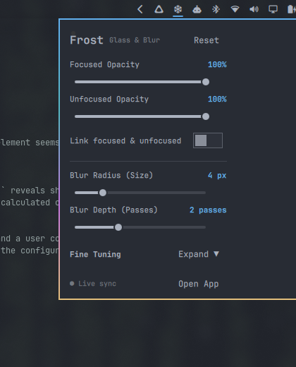
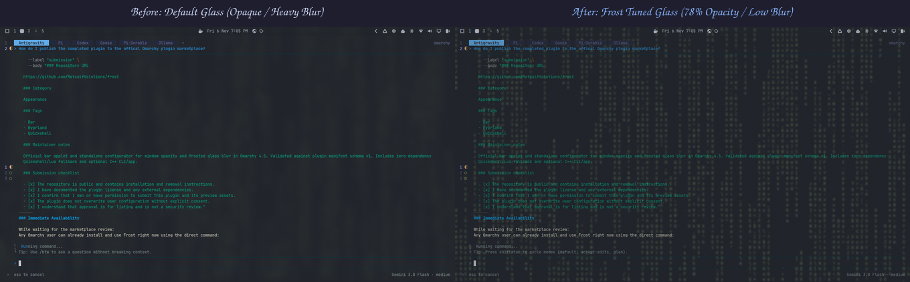

# ❄️ Frost

**Interactive Window Opacity & Frosted Glass Blur Configurator for Omarchy**

[](https://omarchy.org)
[](LICENSE)
[](https://hyprland.org)
[](https://github.com/MetcalfSolutions)

Frost gives Omarchy users instant, fine-grained control over window transparency and frosted glass blur effects across all workspaces. Available as an official Omarchy top bar menu panel, a standalone desktop application, and a headless command-line interface (CLI).

<p align="center">
  
</p>

---

## Table of Contents

- [Visual Showcase (Before & After)](#visual-showcase-before--after)
- [Features](#features)
- [Installation & Removal](#installation--removal)
  - [Omarchy Shell Plugin (1-Step Install)](#1-omarchy-shell-plugin-1-step-install)
  - [Uninstalling Frost](#2-uninstalling-frost)
  - [Standalone Desktop App & CLI (Optional)](#standalone-desktop-app--cli-optional)
- [How to Use](#how-to-use)
  - [1. Menu Bar Panel](#1-menu-bar-panel)
  - [2. Standalone Desktop App](#2-standalone-desktop-app)
  - [3. Command-Line Interface (CLI)](#3-command-line-interface-cli)
- [Architecture & How It Works](#architecture--how-it-works)
  - [Instant Live IPC Evaluation](#instant-live-ipc-evaluation)
  - [Alphabetical Toggle Persistence (Zero Spring-Back)](#alphabetical-toggle-persistence-zero-spring-back)
- [Configuration Reference](#configuration-reference)
- [Wallpaper Callout](#wallpaper-callout)
- [Development & Testing](#development--testing)
- [License](#license)

---

## Visual Showcase (Before & After)

See the difference Frost makes on glassy windows. In the comparison below, default Omarchy glass heavily blurs and opacifies background windows, while Frost is tuned to 78% opacity with a tight 2px blur pass, allowing background animations to shine through with crystal clarity:

<p align="center">
  
</p>

- **Before (Default Omarchy Glass):** Standard presets enforce heavier blur (`passes = 2, size = 4-5`) and 100% opacity, muting background visuals.
- **After (Frost Tuned Glass):** Tailored opacity (`0.78`) and a crisp low-radius blur (`size = 2, passes = 1`) let live desktop shaders and background elements illuminate through active and inactive terminals.

---

## Features

- **Real-Time Live Feedback:** Drag sliders to inspect window opacity and blur dynamically as you move them.
- **Persistent Settings (Zero Spring-Back):** Settings survive Hyprland reloads, theme switches, and toggle refreshes.
- **Top Bar Menu Applet:** Compact dropdown panel with essential controls and an expandable fine-tuning drawer.
- **Independent or Linked Opacity:** Adjust focused and unfocused window opacities separately or link them with one switch.
- **Full Blur Depth & Aesthetics:** Tune radius (size), depth (passes), grain (noise), vibrancy, contrast, and brightness.
- **One-Click Reset:** Instantly revert to default Omarchy glass settings.
- **Omarchy 4.5 Compliant:** Built using Quickshell, `qs.Ui`, and `qs.Commons`, strictly adhering to Omarchy's UI plain-text safety standards and `i18n` localization support.

---

## Installation & Removal

### 1. Omarchy Shell Plugin (1-Step Install)

To install and enable Frost directly in your Omarchy top menu bar:

```bash
omarchy plugin add https://github.com/MetcalfSolutions/frost.git --enable
```

Frost will automatically place its snowflake icon (``) beside your system tray applets on the right side of the top bar.

To adjust its placement or section anytime:

```bash
omarchy bar move frost.panel --section right
```

### 2. Uninstalling Frost

To cleanly remove Frost from your Omarchy shell:

```bash
# Disable without deleting files:
omarchy plugin disable frost.panel

# Or completely remove the plugin:
omarchy plugin remove frost.panel --yes
```

If you wish to reset your Hyprland glass decoration back to default Omarchy presets:

```bash
rm -f ~/.local/state/omarchy/toggles/hypr/zz-frost.lua ~/.config/hypr/frost.lua
hyprctl reload config-only
```

---

<details>
<summary><b>Standalone Desktop App & CLI (Optional)</b></summary>

<br />

If you also want the standalone Qt Quick desktop window and the headless CLI:

#### Via PKGBUILD (Arch Linux / Omarchy Package Manager):

```bash
git clone https://github.com/MetcalfSolutions/frost.git
cd frost/pkgbuild
makepkg -si
```

#### Via Direct Build:

```bash
git clone https://github.com/MetcalfSolutions/frost.git
cd frost
./bin/build
# Installs to ~/.local/bin/frost and registers desktop launcher
```

#### To Uninstall the Standalone App & CLI:

```bash
# If installed via pacman / makepkg:
sudo pacman -R frost

# If installed via ./bin/build:
rm -f ~/.local/bin/frost ~/.local/share/applications/frost.desktop
```

</details>

---

## How to Use

### 1. Menu Bar Panel

Click the snowflake icon (``) in your top right bar to drop down the Frost control card:

- **Focused Opacity Slider (20% – 100%):** Controls active window opacity.
- **Unfocused Opacity Slider (20% – 100%):** Controls background/inactive window opacity.
- **Link focused & unfocused Switch:** Locks both opacities together.
- **Blur Radius (1 – 15 px):** Sets the spread of the Gaussian blur.
- **Blur Depth (1 – 4 passes):** Sets the number of blur passes for extra smoothness.
- **Fine Tuning Drawer (Expand ▼):**
  - **Noise (0.00 – 0.10):** Adds subtle grain texture to glassy surfaces.
  - **Vibrancy (0.00 – 1.00):** Saturates colors passing through the blur.
  - **Contrast & Brightness:** Shapes the glass dynamic range.
- **Quick Actions:**
  - **Left-Click Icon:** Toggle the panel.
  - **Right-Click Icon:** Fast reset to Omarchy presets.
  - **Reset Button:** Reverts all parameters to defaults.
  - **Open App Button:** Launches the full standalone desktop window.

### 2. Standalone Desktop App

Launch Frost from your application launcher or run:

```bash
frost open
```

Provides a dedicated, resizable window with scrollable controls and real-time live preview.

### 3. Command-Line Interface (CLI)

Frost ships with a headless CLI for scripting, shortcuts, and terminal workflows:

```bash
# Query current configuration as human-readable text:
frost get

# Query current configuration as JSON:
frost get --json

# Set specific values:
frost set --active-opacity 0.85 --inactive-opacity 0.60 --blur-size 6 --blur-passes 3

# Reset to Omarchy defaults:
frost reset
```

---

## Architecture & How It Works

### Instant Live IPC Evaluation

Omarchy 4.5 utilizes Hyprland's modern Lua configuration engine. Traditional legacy dispatchers like `hyprctl keyword decoration:...` fail against modern Lua tables.

Frost injects live adjustments directly into Hyprland's running scene graph via IPC evaluation:

```lua
hyprctl eval "hl.config({ decoration = { active_opacity = 0.90, blur = { enabled = true, size = 6, passes = 2 } } })"
```

This guarantees instantaneous visual response with zero latency or compositor stutter while dragging sliders.

### Alphabetical Toggle Persistence (Zero Spring-Back)

In Omarchy, glassy windows are governed by `window-glassy.lua`, which re-asserts default blur values whenever Hyprland reloads configs.

Frost solves this by writing overrides to:
- `~/.local/state/omarchy/toggles/hypr/zz-frost.lua` (loaded alphabetically last by Omarchy's toggle manager, guaranteeing Frost overrides standard defaults).
- `~/.config/hypr/frost.lua` (loaded at the end of `hyprland.lua`).

When you release a slider, Frost commits your changes without causing the slider to snap or spring back to defaults.

---

## Configuration Reference

Default presets aligned with Omarchy Glass:

| Parameter | Default | Range | Description |
| :--- | :--- | :--- | :--- |
| `active_opacity` | `1.00` | `0.20` – `1.00` | Opacity of the focused window |
| `inactive_opacity` | `1.00` | `0.20` – `1.00` | Opacity of inactive background windows |
| `blur_size` | `4` | `1` – `15` px | Blur sampling radius |
| `blur_passes` | `2` | `1` – `4` passes | Number of blur filter iterations |
| `blur_noise` | `0.01` | `0.00` – `0.10` | Surface noise / frosted grain |
| `blur_contrast` | `1.00` | `0.50` – `2.00` | Glass contrast |
| `blur_brightness`| `0.75` | `0.50` – `1.50` | Glass brightness |
| `blur_vibrancy` | `0.35` | `0.00` – `1.00` | Color saturation enhancement |

---

## Wallpaper Callout

The live falling digital code wallpaper featured behind the transparent windows in the screenshots is rendered by the **[omatrix](https://github.com/0x1ocean/omarchy-omatrix)** shell plugin (`io.github.0x1ocean.omatrix`). It renders `cmatrix` directly on the bottom Wayland layer in your active theme's terminal palette.

---

## Development & Testing

Frost includes an automated QtTest suite validating config serialization, theme integration, rounding checks, and fallback mechanisms.

```bash
# Run unit tests:
cd tests
make
./frost_test

# Or use the test runner:
./bin/test

# Validate plugin manifest schema:
omarchy plugin validate .
```

---

## License

MIT License. Designed and crafted by [metcalf.solutions](https://github.com/MetcalfSolutions) for the [Omarchy](https://omarchy.org) community.
